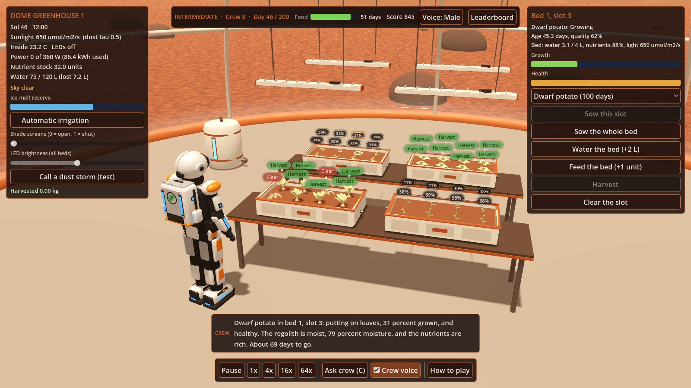

# Mars Farming

Grow food in a glass dome on Mars. You run a greenhouse of regolith beds under the Martian sun: sow, water and
feed the crops, keep the little LED lights going through the night, and ride out the dust storms that dim the sky
and cut the solar power that feeds the lights. Built in Godot 4.6.3 with a C++ GDExtension, in the same
code-generated graphics style as [Aevoria Simulator](https://github.com/Overby-Industries/aevoria-simulator) and
its sibling [Aevoria Space Station Farming](https://github.com/Overby-Industries/aevoria-space-station-farming).

**Status: an early start.** One dome, four crops (potato is the staple), a growth model with tests, procedural
plants, Blender-modelled props, dust storms, and a playable dome scene. Not a finished game. See
[docs/DESIGN.md](docs/DESIGN.md) for what exists and what does not.



## What is here

| Path | What it is |
|---|---|
| `core/` | The farm simulation in plain C++17, header-only, no Godot types: `species.hpp` (the crops), `plant.hpp` (growth, stress, harvest), `bay.hpp` (beds, lights, sun, dust, water, nutrients, clock) |
| `src/` | The GDExtension: `FarmBay` (the simulation as a node), `FarmShapeBuilder` (recipe to 3D shape), `FarmSkinGenerator` (recipe to texture), plus the mesh and plant geometry code |
| `godot/` | The Godot project: `scenes/dome.tscn` (the game slice), `scenes/showcase.tscn` (every crop at every stage), `scripts/`, `models/` (the Blender props as `.glb`), `tests/` |
| `blender/` | `build_assets.py`: builds the props in `godot/models/` from code |
| `tests/` | The C++ test suite for `core/` (CMake) |
| `docs/` | [DESIGN.md](docs/DESIGN.md) and [GRAPHICS_GUIDE.md](docs/GRAPHICS_GUIDE.md) |

**The core is shared with the station game.** `core/`, `tests/` and most of `src/` started as a copy of the same
code in [aevoria-space-station-farming](https://github.com/Overby-Industries/aevoria-space-station-farming).
There is no shared library yet, so a fix made in one repository has to be carried to the other by hand.

## Build and run (Windows)

You need Godot 4.6.3, Python 3 with SCons (`pip install scons`; run it as `python -m SCons`), and Visual Studio's
C++ tools (MSVC). Clone with submodules (`git clone --recursive`), then from the repo root:

```
python -m SCons platform=windows target=template_debug -j4
```

The first build compiles godot-cpp and takes a while (tens of minutes); after that, a change under `src/` or
`core/` rebuilds in seconds. It writes `godot/bin/libmarsfarm.windows.template_debug.x86_64.dll`. Open the `godot/`
folder in Godot 4.6.3 and run it (the main scene is the dome). Build `template_release` as well before exporting.

**Controls:** left-click a slot in a bed to select it; right-drag orbits the camera; the wheel zooms. Sow the slot
or the whole bed, water and feed the bed, harvest when a plant says Ready. The sliders set the shade screens and the
LED brightness; "Call a dust storm" starts a storm to see what it does. The buttons along the bottom set the speed
of time.

## Tests

The simulation core, in WSL or any Linux or macOS shell with CMake and a C++17 compiler:

```
cmake -S . -B build -DCMAKE_BUILD_TYPE=Release
cmake --build build
ctest --test-dir build --output-on-failure
```

The Godot side, with the extension built (headless, so no window):

```
godot --headless --path godot --import
godot --headless --path godot -s res://tests/smoke.gd
godot --headless --path godot -s res://tests/assets_test.gd
godot --headless --path godot -s res://tests/dome_test.gd
```

On a fresh checkout the first `--import` can exit with a crash code (on Windows with Godot 4.6.3 it does, from
inside Godot itself, after the import has finished); run it a second time and it exits cleanly.

`godot/tests/shot.gd` captures a frame of any scene with the real renderer, and `shot_growth.gd` plays a short
session (sow, grow some days, optionally a storm or a night) and captures that, for looking at the art.

## Release to itch.io

The game is on itch.io at [overby-industries.itch.io/mars-farming](https://overby-industries.itch.io/mars-farming). `deploy_to_itch.ps1` builds the extension (debug, which the editor loads to export, and release, which the game ships), exports the Windows release build to `godot/builds/windows-release/`, starts the exported game headless as a smoke test, and pushes it with [butler](https://itch.io/docs/butler/):

```
powershell -File deploy_to_itch.ps1 -NoPush    # everything except publishing: the way to check that it works
powershell -File deploy_to_itch.ps1            # build, export, test, push (public: only when you mean to release)
```

It needs Godot 4.6.3 with its Windows export templates, SCons and MSVC (as for building above), and, unless you use `-NoPush`, butler logged in (`butler login`) as an account that may push to the page. Each tool is found from a parameter, an environment variable (`GODOT_EXE`, `BUTLER_EXE`, `PYTHON`) or the usual places; the script's header says how. After a push, `sync_version.ps1` writes the itch.io build number into `godot/export_presets.cfg` as version `0.1.N`: commit that as "Sync version to itch.io build #N", together with any `.uid` or `.import` files Godot wrote. The first release build also compiles godot-cpp for `template_release`, which takes a long time.

## A note on the numbers

Every growth time, light need and yield in `core/species.hpp`, and every weather and power number in
`godot/scripts/dome.gd`, is a **design value**: a starting point, not a validated agronomic or engineering model.
Tune them by playing.

## Roadmap

Crew food demand and a reason to grow one crop over another, dust on the solar panels and on the dome, equipment
faults and events, a better storm model, crops chosen for Mars, a save file, sound, tuning, and a licence.

## License

Not chosen yet.
