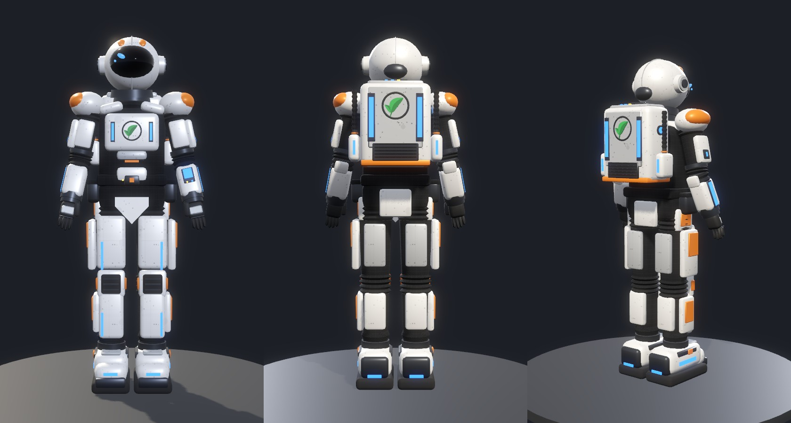
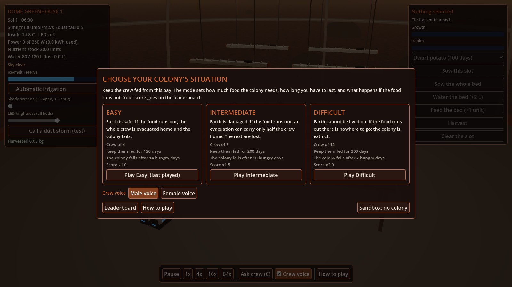
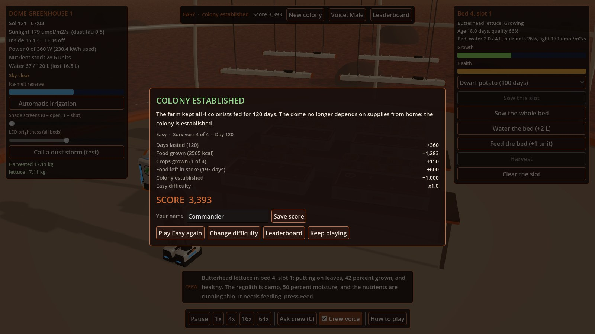
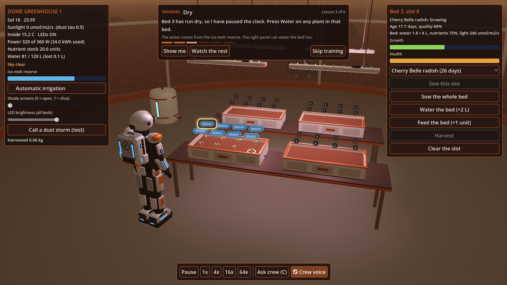

# Mars Farming

Grow food in a glass dome on Mars. You run a greenhouse of regolith beds under the Martian sun: sow, water and
feed the crops, keep the little LED lights going through the night, and ride out the dust storms that dim the sky
and cut the solar power that feeds the lights. Built in Godot 4.6.3 with a C++ GDExtension, in the same
code-generated graphics style as [Aevoria Simulator](https://github.com/Overby-Industries/aevoria-simulator) and
its sibling [Aevoria Space Station Farming](https://github.com/Overby-Industries/aevoria-space-station-farming).

**Status: an early start.** One dome, four crops (potato is the staple), a growth model with tests, procedural
plants, Blender-modelled props, dust storms, a playable dome scene with a floating button over every crop, a crew astronaut
built from modular suit components who talks you through the farm, a short training for new players, and a colony to feed on three difficulties, with a score and a leaderboard. Not a finished game.
See [docs/DESIGN.md](docs/DESIGN.md) for what exists and what does not.


## What is here

| Path | What it is |
|---|---|
| `core/` | The farm simulation in plain C++17, header-only, no Godot types: `species.hpp` (the crops), `plant.hpp` (growth, stress, harvest), `bay.hpp` (beds, lights, sun, dust, water, nutrients, clock), `colony.hpp` (the colony: food, hunger, the three difficulties, the score) |
| `src/` | The GDExtension: `FarmBay` (the simulation as a node), `FarmShapeBuilder` (recipe to 3D shape), `FarmSkinGenerator` (recipe to texture), plus the mesh and plant geometry code |
| `godot/` | The Godot project: `scenes/dome.tscn` (the game slice), `scenes/training.tscn` (the training for new players), `scenes/showcase.tscn` (every crop at every stage), `scripts/` (including `slot_buttons.gd`, the floating buttons over the slots, `crew_voice.gd`, the crew member's voice, `training.gd`, the coach, `colony_ui.gd` and `leaderboard.gd`, the colony screens, and `astronaut.gd`, which assembles the crew member), `models/` (the Blender props as `.glb`, and the astronaut's eleven suit components in `models/astronaut/`), `tests/` |
| `blender/` | `build_assets.py` builds the props in `godot/models/` from code; `build_astronaut.py` builds the suit's components in `godot/models/astronaut/` |
| `tests/` | The C++ test suite for `core/` (CMake) |
| `docs/` | [DESIGN.md](docs/DESIGN.md) and [GRAPHICS_GUIDE.md](docs/GRAPHICS_GUIDE.md) |

**The core is shared with the station game.** `core/`, `tests/` and most of `src/` started as a copy of the same
code in [aevoria-space-station-farming](https://github.com/Overby-Industries/aevoria-space-station-farming).
There is no shared library yet, so a fix made in one repository has to be carried to the other by hand.

## The crew astronaut



A chunky EVA suit, 1.8 m tall: glossy white armour over a matte woven-fabric undersuit with corrugated joints, orange
accents, small blue light strips, a dark visor and a green leaf on the chest and on the backpack. It stands on the walkway
in front of the near bench and looks over the beds at the dome and the plain beyond; its helmet turns slowly and its chest
breathes. It has no collision and you do not steer it, but it is the crew's voice (see *Playing*): its head turns to look at
whatever it is talking about. (Its orange happens to be Mars's rust, too.)

It is built as **separate modular components**: helmet, torso, backpack, an arm, a glove, a leg and a boot for each
side, each its own `.glb` with its origin at its joint, hung on named sockets by `godot/scripts/astronaut.gd`. Any part can
be swapped, recoloured or left out (`recipe` in that script), and the same files are used by
[Aevoria Space Station Farming](https://github.com/Overby-Industries/aevoria-space-station-farming). See
[docs/GRAPHICS_GUIDE.md](docs/GRAPHICS_GUIDE.md).

## Playing

Every crop slot has a **floating button** over it that says what its plant needs next, and does it when you press it
(pressing also selects the slot, so the right-hand panel shows its details):

| Button | The plant or slot |
|---|---|
| **+** | the slot is empty: sow the chosen crop |
| **42%** | all is well: how far the plant has grown |
| **Water**, **Feed** | its bed has run low on water or on nutrients |
| **Harvest** | it is ready (or overripe) |
| **Clear** | it has died |

You can also click a slot or a plant to select it and use the buttons in the right-hand panel (sow the slot or the whole
bed, water, feed, harvest, clear). Right-drag orbits the camera and the wheel zooms; the buttons along the bottom set the
speed of time. The sliders set the shade screens and the LED brightness; "Call a dust storm" starts a storm to see what it does. The LED bars hang more than a metre above the soil, over the top of even a full-grown tomato, so every slot can
be seen and picked; from a steep or sideways view a bar that would stand in front of a slot fades to a ghost.

**The crew voice.** The astronaut says what needs to happen next (a crop is ready, a bed is dry or short of nutrients, the
water is low, slots are waiting for seeds), describes whatever you select (the crop, its stage and health, and the moisture
and nutrients of the regolith), and reports news as it happens (a crop sprouts, a harvest, a plant lost). In a dust storm it warns about the sun and the solar power. *Ask crew*
(or the **C** key) gives the most useful thing to do right now. Every line is captioned on screen, and the astronaut turns its head to
the plant it is talking about. The speech is the operating system's text-to-speech through Godot, so it uses the voices the PC
already has and ships none (it needs `audio/general/text_to_speech` on in `project.godot`, which it is); the *Crew voice* box
switches the speech off and leaves the captions. With no voices installed, and in headless runs, there are only captions.

## The colony, three difficulties and a score



You are feeding a colony. When a game starts you choose **how hard its situation is** and, if the PC has both, a **male or a female crew voice**.
The bar along the top then shows the mode, the crew, the day, how many days of food are in store, and the score. Harvests fill the store, the
crew eats from it every hour, and the game is won by keeping the crew fed for the whole goal period:

| Mode | Crew | Keep them fed | If the food runs out |
|---|---|---|---|
| **Easy** | 4 | 120 days | Earth is safe: the whole crew is evacuated home and the colony fails |
| **Intermediate** | 8 | 200 days | Earth is damaged and can take only half the crew back: the rest are lost |
| **Difficult** | 12 | 300 days | Earth cannot be lived on: there is nowhere to go, and the colony is extinct |

A colony that grows nothing always fails: it eats its store, goes hungry for 14, 10 or 7 days, and then the ending comes.
The dome grows less than the station (its potato takes about 150 days under the sun, and dust storms dim it), so its colony asks for about half the food, with a longer reserve on the two harder modes.

The score is worked out by the core, so it is the same however the game is played: 3 points a day the colony lasts, 0.5 for each kcal grown (every
crop has its food energy: a potato feeds a colony far better than a lettuce), 150 for each different crop harvested, 10 a day of food in store, 1,000
for making it, less 40 for each plant lost and 25 for each hungry day, times 1, 1.5 or 2 for the mode. The ending shows how it adds up and asks for a
name for the **leaderboard**: the ten best runs for each mode, kept on this PC (nothing is sent anywhere). *Keep playing* carries on in the same bay
after an ending, and *Sandbox* in the picker skips the colony altogether. The male and the female voice are the PC's own text-to-speech voices
(Windows has David and Zira, for instance); the choice is remembered, and a PC with only one kind of voice is told so.



## Training for new players



The **How to play** button at the bottom of the game opens `scenes/training.tscn`: the real game with a coach on top. A panel says
what to do, a ring marks the control to use, and the crew reads each step aloud. There are six lessons, the same journey
that `godot/tests/crew_ui_test.gd` drives through the game: **sow** (a slot, then a whole bed), **grow** (run the clock), **dry** (a bed
runs low: press Water), **harvest** (a crop is ripe: press Harvest), **select** (click a plant and hear it described) and **ask**
(press Ask crew). *Show me* does the step with a pointer on the real buttons, *Skip 5 days* helps the impatient, and *Watch it all*
plays the whole training by itself. It takes about two minutes, and ends with *Start a new game* or *Keep this farm* (carry on in the
farm you grew).

## Build and run (Windows)

You need Godot 4.6.3, Python 3 with SCons (`pip install scons`; run it as `python -m SCons`), and Visual Studio's
C++ tools (MSVC). Clone with submodules (`git clone --recursive`), then from the repo root:

```
python -m SCons platform=windows target=template_debug -j4
```

The first build compiles godot-cpp and takes a while (tens of minutes); after that, a change under `src/` or
`core/` rebuilds in seconds. It writes `godot/bin/libmarsfarm.windows.template_debug.x86_64.dll`. Open the `godot/`
folder in Godot 4.6.3 and run it (the main scene is the dome). Build `template_release` as well before exporting.

## Tests

The simulation core, in WSL or any Linux or macOS shell with CMake and a C++17 compiler:

```
cmake -S . -B build -DCMAKE_BUILD_TYPE=Release
cmake --build build
ctest --test-dir build --output-on-failure
```

The Godot side, with the extension built (headless, so no window):

```
godot --headless --path godot --import
godot --headless --path godot -s res://tests/smoke.gd
godot --headless --path godot -s res://tests/assets_test.gd
godot --headless --path godot -s res://tests/astronaut_test.gd
godot --headless --path godot -s res://tests/dome_test.gd
godot --headless --path godot -s res://tests/crew_ui_test.gd
godot --headless --path godot -s res://tests/training_test.gd
godot --headless --path godot -s res://tests/colony_ui_test.gd
```

On a fresh checkout the first `--import` can exit with a crash code (on Windows with Godot 4.6.3 it does, from
inside Godot itself, after the import has finished); run it a second time and it exits cleanly.

`godot/tests/shot.gd` captures a frame of any scene with the real renderer, and `shot_growth.gd` plays a short
session (sow, grow some days, optionally a storm or a night) and captures that, for looking at the art; the picture at the
top is `shot_growth.gd -- dome.jpg 45 noon default 11` (a name ending in `.jpg` is saved as a small JPEG into
`godot/shots/`; the last number is the second of the astronaut's idle animation to freeze, and 11 s has its head turned toward
the beds). `shot_astronaut.gd` photographs the suit on a bare stage (`shot_astronaut.gd -- astronaut.jpg 0 front,back,three_quarter`), and
`shot_training.gd` photographs the training at one moment (the picture of the training is `shot_training.gd -- training.jpg dry`; the
others are `welcome`, `sow`, `sow2`, `grow`, `harvest`, `select`, `ask`, `finish` and `watch`), and `shot_colony.gd` photographs the colony screens (`shot_colony.gd -- difficulty.jpg picker`; the others are `bar`,
`ending`, `success` and `board`).

## Release to itch.io

The game is on itch.io at [overby-industries.itch.io/mars-farming](https://overby-industries.itch.io/mars-farming). `deploy_to_itch.ps1` builds the extension (debug, which the editor loads to export, and release, which the game ships), exports the Windows release build to `godot/builds/windows-release/`, starts the exported game headless as a smoke test, and pushes it with [butler](https://itch.io/docs/butler/):

```
powershell -File deploy_to_itch.ps1 -NoPush    # everything except publishing: the way to check that it works
powershell -File deploy_to_itch.ps1            # build, export, test, push (public: only when you mean to release)
```

It needs Godot 4.6.3 with its Windows export templates, SCons and MSVC (as for building above), and, unless you use `-NoPush`, butler logged in (`butler login`) as an account that may push to the page. Each tool is found from a parameter, an environment variable (`GODOT_EXE`, `BUTLER_EXE`, `PYTHON`) or the usual places; the script's header says how. After a push, `sync_version.ps1` writes the itch.io build number into `godot/export_presets.cfg` as version `0.1.N`: commit that as "Sync version to itch.io build #N", together with any `.uid` or `.import` files Godot wrote. The first release build also compiles godot-cpp for `template_release`, which takes a long time.

## A note on the numbers

Every growth time, light need and yield in `core/species.hpp`, and every weather and power number in
`godot/scripts/dome.gd`, is a **design value**: a starting point, not a validated agronomic or engineering model.
Tune them by playing. The same goes for what the colony asks of the bay, its reserves and patience, and the score (`core/colony.hpp`).

## Roadmap

Dust on the solar panels and on the dome, equipment faults and events, a better storm model, crops chosen for Mars, a save file,
sound effects and music, an online leaderboard, and tuning.

## License

[Apache 2.0](LICENSE), like the other software repositories of Overby Industries. It covers the code and the graphics and models the code generates. It does not license the project's name (section 6 of the licence). Built on the Godot Engine and godot-cpp, both MIT-licensed.
