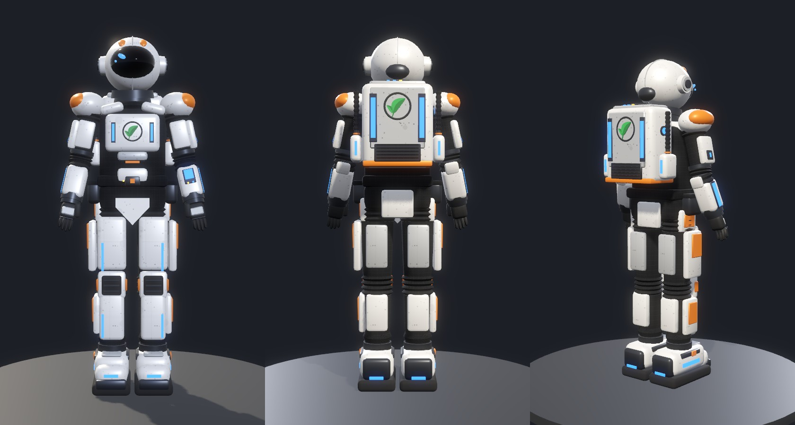

# Graphics guide

The dome follows the same rule as Aevoria Simulator (see its `docs/GRAPHICS_GUIDE.md`): the visuals are generated
from data. A look is a dictionary; only a genuinely new shape needs C++. Scale is **1 Godot unit = 1 metre**.
The palette is Martian: dusty white `#EDE6DC`, rust orange `#C5602E`, basalt `#2E2825`, regolith `#6E3B22`,
and a butterscotch sky. The crew astronaut keeps its own colours (white, orange, black, blue and green) on every planet; a
`recipe` can tint it (see below).

## Data or code?

| You want to... | Where | Rebuild? |
|---|---|---|
| Resize or recolour a bed, light or tank; change a plant's scale | The recipe dictionary in GDScript | No |
| Retune a crop (growth time, light, yield) | `core/species.hpp` | Yes |
| Change the soil, ground or panel texture | A skin recipe in GDScript | No |
| Move or add a prop, change the sky or the weather | `godot/scripts/dome.gd` | No |
| Add a new shape, or change how a crop looks | `src/farm_shape_builder.cpp`, `src/plant_meshes.cpp` | Yes |
| Replace a procedural shape with a modelled one | Add `"model": "res://models/x.glb"` to its recipe | No |
| Recolour, swap or leave out a part of the astronaut | Its `recipe` (see below) | No |
| Change the astronaut's shapes | `blender/build_astronaut.py`, then re-export | No (re-import in Godot) |
| Change a modelled prop | `blender/build_assets.py`, then re-export | No (re-import in Godot) |

## `FarmShapeBuilder`

```gdscript
var builder := FarmShapeBuilder.new()
var node: Node3D = builder.build_node({"shape": "planter_tray", "rows": 2, "cols": 4})
```

Keys common to every shape: `shape`, `name`, `model`, `model_scale`, `albedo_color`, `roughness`, `metallic`,
`emission_color`, `emission_energy`.

| Shape | Keys and notes |
|---|---|
| `box`, `cylinder`, `capsule`, `sphere` | Godot's own primitives: `size`, or `radius` and `height` |
| `planter_tray` | The regolith bed. `size` (default 1.2 x 0.22 x 0.6 m), `wall`, `rows`, `cols`, `soil_color`, `soil_skin`, `accent_color`, `base_color`. Origin at the middle of the bottom. `get_slot_positions(recipe)` returns the planting spots, row-major, on the soil |
| `grow_light` | The LED bar. `length` (1.2 m). Origin at the mount, hangs down. Its LED material is in the node's `led_material` metadata: set `emission_energy_multiplier` to dim or switch it |
| `tank` | The ice-melt tank. `radius`, `height`, `dome`. Origin at the middle of the bottom |
| `plant` | `species` (`lettuce`, `radish`, `tomato`, `potato`), `progress` 0..1, `stage` (the `FarmBay.STAGE_*` constants), `health` 0..1, `seed`, `scale`. Origin on the soil. The same inputs always give the same plant |

With no colours given, the shapes use the Mars palette above. A plant is rebuilt when its stage changes or its
progress moves by about 2%; the dome script shows the pattern (`_refresh_slot`). The heaviest plant is a few
thousand triangles.

## The model seam and the Blender assets

If a recipe names a `model` that exists, the imported scene is returned instead of the procedural shape, and
nothing else changes. If the file is missing, the procedural shape is used, so the game never breaks for want
of an asset. A modelled replacement must match the procedural one's dimensions and origin.

`blender/build_assets.py` builds the props in `godot/models/` from code, so they can be regenerated and tuned like
everything else:

```
blender -b --factory-startup --python blender/build_assets.py -- godot/models [asset ...]
```

(Built with Blender 5.3. Name assets after the `--` to rebuild only those; then run `godot --headless --path godot
--import`.)

| Asset | Replaces | Size and origin |
|---|---|---|
| `regolith_bed.glb` | `planter_tray` | 1.2 x 0.22 x 0.6 m, origin at the middle of the bottom, soil surface at y = 0.17 m; eight `Slot_0`..`Slot_7` empties exactly where `get_slot_positions()` puts them |
| `led_bar.glb` | `grow_light` | 1.2 m, origin at the mount point; the `LED_Emissive` material is the glowing panel |
| `ice_tank.glb` | `tank` | 0.7 m across, 0.9 m tall, origin at the middle of the bottom; the `Gauge_Emissive` material is the level window |
| `supply_crate.glb` | (extra) | 0.4 x 0.25 x 0.3 m, origin at the middle of the bottom |
| `airlock.glb` | (extra) | 1.5 x 2.2 x 0.5 m, origin at the middle of the bottom, the door faces +z; `Gauge_Emissive` is the porthole, `Status_Emissive` the status light |

The geometry in the script is written in Godot space (x right, y up, z toward the viewer) and `G()` converts it
to Blender's axes, so that the glTF exporter's Y-up conversion lands every point back on the same Godot
coordinates. Materials are plain Principled BSDF colours with no textures, named so that game code can find
them (`LED_Emissive`, `Gauge_Emissive`, `Status_Emissive`). The `.glb.import` files are tracked, so the import
settings are the same on every checkout. `godot/tests/assets_test.gd` builds each asset both ways and checks
that the sizes, origins and slots agree.

## The astronaut: a modular suit



A chunky sci-fi EVA suit, about 1.8 m tall (the same crew member as in Aevoria Space Station Farming):
white and light-grey **armour** (smooth, glossy painted composite with a few chips and scuffs) over a black **undersuit**
of a different material, a technical fabric (matte, a woven twill with a heavier ripstop thread every few centimetres, lit
through a normal map, with corrugated flexible joints at the neck, shoulders, elbows, hips, knees and ankles); orange
accents (shoulder caps, hips, thigh and shin panels, the strap under the backpack); thin glowing blue light strips and a
few status lights as small accents; a round helmet with a headset disc on each side and a dark reflective visor; black
gloves, chunky boots, knee armour; a boxy life-support backpack with a vent grille, valves and a hose; and a green leaf in a
dark ring on the chest and on the backpack.

It is **not one model**. It is eleven components, each its own glb in `godot/models/astronaut/`, so that each can be
animated, swapped, recoloured or left out, and the same files serve every game:

| Component | File | Origin (its joint) | Offers sockets for |
|---|---|---|---|
| Torso: pelvis, belt, chest, neck | `torso.glb` | the waist | `Socket_Neck`, `Socket_Back`, `Socket_ShoulderR/L`, `Socket_HipR/L`. Has a `Chest` pivot that breathes |
| Helmet | `helmet.glb` | the base of the neck | |
| Backpack | `backpack.glb` | the middle of its mounting face | |
| Arm (right, left) | `arm_r.glb`, `arm_l.glb` | the shoulder | `Socket_WristR/L`. Has a `ForearmR/L` pivot at the elbow |
| Glove (right, left) | `glove_r.glb`, `glove_l.glb` | the wrist | |
| Leg (right, left) | `leg_r.glb`, `leg_l.glb` | the hip | `Socket_AnkleR/L`. Has a `ShinR/L` pivot at the knee |
| Boot (right, left) | `boot_r.glb`, `boot_l.glb` | the ankle | |

Every component is modelled in the suit's own axes (+x is the figure's right hand, y up, the figure **faces -z**, Godot's
forward) with its limbs hanging straight down; the stance (arms out 12 degrees, elbows bent 15) is data in `REST_DEG` in
`godot/scripts/astronaut.gd`, not baked in. A component hangs on a **socket**: an empty named `Socket_*` that its host
component places (a torso with other proportions brings its own sockets), so swapping a part needs no other change. Meshes
are named `<Pivot>_<Material>` and the materials say what they are: `Suit_White`, `Suit_Grey`, `Undersuit`, `Suit_Orange`,
`Metal_Dark`, `Rubber`, `Glove`, `Strip_Blue` (the glow), `Indicator_Amber`, `Visor`, `Visor_Glint`, `Logo_Green`, `Logo_Dark`.

`blender/build_astronaut.py` builds the components from code, like the props:

```
blender -b --factory-startup --python blender/build_astronaut.py -- godot/models/astronaut [component ...]
godot --headless --path godot --import
```

(Name components after the `--` to rebuild only those: `torso`, `helmet`, `backpack`, `arm_r`, `arm_l`, `glove_r`, `glove_l`,
`leg_r`, `leg_l`, `boot_r`, `boot_l`.) Never call `bmesh.ops.bevel` without `profile=0.5`: Blender then makes a square-profile,
stair-stepped bevel.

`godot/scripts/astronaut.gd` puts the figure together and runs the idle animation (the helmet turns slowly, the chest
breathes, the arms sway a little: a handful of rotations, no skeleton):

```gdscript
const Astronaut = preload("res://scripts/astronaut.gd")
var man := Astronaut.new()
man.recipe = {"colors": {"Suit_Orange": Color("2f9e6b")}, "hidden": ["Backpack"]}   # every key is optional
man.position = Vector3(-1.7, 0, 1.6)
add_child(man)                  # assembles itself on entering the tree
man.pose(3.0)                   # freeze the idle animation at 3 s (the tests and the screenshots do)
```

Recipe keys: `parts` `{component: glb path}` swaps a component for another file; `colors` `{material name: Color}`
recolours (a glowing material changes its glow); `hidden` `[component names]` leaves some out; `skins` `false` leaves the
surfaces plain; `idle` `false` switches the animation off. A missing file leaves that part out and the rest standing (a
missing torso leaves a capsule). The boots are grounded automatically, so legs and boots of another length still stand on
y = 0. The two skins are made from code (`SKINS` in the script), tiled by triplanar mapping so the models need no UVs, and
shared by every astronaut: the armour is white with scattered chips, the undersuit a woven twill with a normal map.

Checks: `godot/tests/astronaut_test.gd` (every component's origin and sockets, the assembled figure's height, facing and
footprint, the blue as a small share of the surface, the idle, the two skins, recipes and missing files),
`godot/tests/shot_astronaut.gd` (front, back, three quarters and close-ups on a bare stage).

## The floating buttons, the voice and the coach

The HUD is built in code (`dome.gd`, `_build_hud()`). Three scripts do the newer parts, and none of them needs more of the scene than
a `bay`, `BED_CENTERS`, `_slot_offsets`, `_cam`, `selected`, `select_slot()` and the `action_*()` calls, so both farming games use the same files:

- `scripts/slot_buttons.gd`: one `Button` per slot, placed over the top of its plant (`Camera3D.unproject_position`), sized by its
  distance from the camera, and nudged apart from its neighbours when two would overlap (a thin line then leads back to the plant). What a
  button says is `SlotButtons.state_of(bay, bed, slot)`, one function of the plant and its bed that the tests and the voice use too. The
  colours by kind (green Harvest, blue Water, Feed, red Clear, a dim pill for `+` and the growth percentage) are the `palette` it is
  given. It is the first child of the HUD, so the panels draw over it and take the clicks that fall on them.
- `scripts/crew_voice.gd`: the lines (`advice()`, `describe_slot()`, `status_line()`), the pauses between them, the caption (a panel
  along the bottom, `CrewCaption`) and the speech (`DisplayServer.tts_speak`). The astronaut looks where `look_at_point()` says. The
  scene may add its own notes with a `voice_notes()` method.
- `scripts/training.gd`: the coach panel on its own `CanvasLayer` above the HUD, a pulsing ring drawn round the control to use (a
  `StyleBoxFlat` border) or round a plant, and an arrow pointer for "Show me". It takes its colours from the game's `hud_palette`.
  `scripts/training_driver.gd` has the helpers for the parts about time, shared with the tests.

The LED bars are named `GrowLight0` to `GrowLight3` and hang `LIGHT_HEIGHT` (1.55 m) above the bench. `fade_blocking_lights()` raises the
`transparency` of any bar that stands between the camera and a slot, and lowers it again when the view moves on.

Checks: `godot/tests/crew_ui_test.gd` (the buttons and the voice, the voice read as text), `godot/tests/training_test.gd` (the coach played
through as a player and with "Watch it all"), `godot/tests/dome_test.gd` (bar height and fading, a clear start view), and
`godot/tests/shot_training.gd` (the training at any moment, for looking at it).

## `FarmSkinGenerator`

```gdscript
var tex := FarmSkinGenerator.new().generate_texture({"kind": "soil", "seed": 3}, 256, 256)
```

Recipe keys: `kind` (`cellular`, `soil`, `panel`), `seed`, `frequency`, `dark_color`, `base_color`,
`highlight_color`; `panel` also takes `cells` and `seam_color`. The same seed always gives the same texture. The
dome uses `soil` twice: dark regolith in the beds, and a 512 x 512 rust ground texture tiled 40 times over the plain.

## The world around the beds

`godot/scripts/dome.gd` builds everything that is not a bed or a plant, from recipes and Godot primitives:

- the **dome**: a glass hemisphere (alpha-blended, no shadow), four vertical and three horizontal ribs
  (`TorusMesh`, no shadow, because a web of rib shadows hides the beds), a floor disc, and a thin rust foundation
  ring around the rim;
- the **plain**: a 240 m plane with the rust ground texture, seventy rocks (flattened spheres) and a line of low hills;
- the **sky**: a `ProceduralSkyMaterial` whose colours, the sun's energy and angle, the fog and the ambient light
  all follow the hour and the dust (`_update_sky()`), so noon, night and a storm each look different.

## Adding a crop

1. Add a row to `kSpecies` in `core/species.hpp` (the tests check the table is well formed).
2. Add a colour case in `palette_for()` and, if it needs a new growth form, a function in
   `src/plant_meshes.cpp` (all in that file).
3. Rebuild. The crop appears in the dome's crop list automatically.

## One gotcha

Godot treats **clockwise** triangles as front faces, and it flips the normal of a back face even when culling
is off, so a wrongly wound triangle is lit inside out. `MeshBuilder::tri()` (`src/mesh_builder.h`) orients every
triangle from the normals it is given, so shape code never has to think about vertex order.

A second one, from this scene: a solid floor or base under a prop buries it. The foundation under the dome is a
ring for that reason; a disc as thick as a crate would hide the crates.
